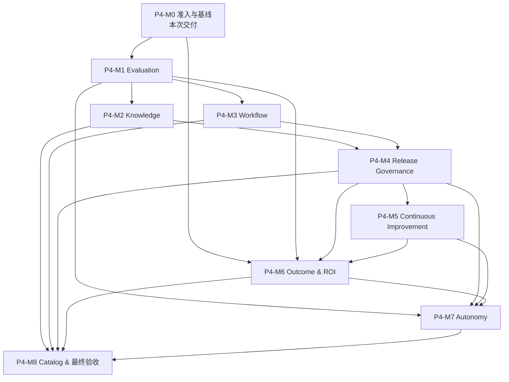

# P4 里程碑 DAG 与 Worktree 计划

> 交付物：P4-M0 第 9/10 份
> 依据：V6.0 §31（DAG 与审批）、§28.4（Worktree 与并行）、§29（RACI）、P4-GOV-003

---

## 1. 里程碑 DAG



**并行窗口**：M2 与 M3 在 M1 契约冻结后可并行；M6 的指标定义可在 M0 后提前准备（本册已冻结口径），但正式验收依赖 M1/M4/M5 的真实数据。

**本仓库实际执行顺序建议**：

```
M0（本次） → M1 → M3 ∥ M2 → M4 → M5 → M6 → M7 → M8
```

先 M3 后 M2 的理由：Workflow 的 DAG 校验可复用现有 `task_dependencies` 与 `_dependency_cycle`，而 Knowledge 需要全新的存储/检索栈（ADR-005），风险更高、隔离要求更强，放在 Workflow 之后可以把 M2 的 ACL 设计与 M3 的权限模型统一。

---

## 2. 阶段门禁

| 阶段 | 进入条件 | 完成后审批 | 本仓库附加条件 |
|---|---|---|---|
| P4-M0 | 用户裁定（已完成 2026-11-06） | **用户批准 P4-M1** | 业务 Owner 指定（待定） |
| P4-M1 | 数据授权、评估 Owner、运行环境明确 | 用户批准 M2/M3 | GAP-1/2/3 完成 |
| P4-M2 | 项目隔离与知识安全测试通过 | 批准知识进入试点 | Secret 扫描上线 |
| P4-M3 | Workflow 契约、权限、失败路径通过 | 批准首批 Workflow 发布 | 复用 scheduler |
| P4-M4 | Manifest、审批、Canary、回滚通过 | 批准受控生产 Release | 恢复演练通过 |
| P4-M5 | 变更提案、沙箱、回滚链路通过 | 批准受控改进闭环 | — |
| P4-M6 | 指标口径、成本、业务确认通过 | 批准价值报告口径 | cost 列 Expand 完成 |
| P4-M7 | 独立风险评审与 Policy 集成通过 | 单独批准自动化范围 | P0 上限 A2 |
| P4-M8 | 多项目隔离、稳定性、最终验收通过 | 用户确认第四期完成 | 两隔离项目越权测试 |

**不可跨越**：任何阶段不得自动进入下一阶段；每次跨越必须有一次用户明确批准。

---

## 3. Definition of Ready（每个里程碑开工前必须满足）

V6.0 §28.2。通用 DoR：

1. 需求编号已分配并写入 RTM。
2. 依赖里程碑已 ACCEPTED。
3. 契约（API / Schema / Event）已冻结并写入 `openapi.py`。
4. 数据归属与权限已判定（哪个项目、哪个分类、哪个角色）。
5. 测试策略与验收标准已写明（含失败判据）。
6. 回滚方案已写明。
7. 文件 Owner 已指派，无冲突。
8. Worktree 已创建。

**不满足 DoR 不得开工**——这是防止"边做边定"的唯一手段。

---

## 4. Worktree 与分支计划

### 4.1 目录布局（沿用 `~/agent-team/<code>-team`）

```
~/agent-team/
├── legacy-team/
│   └── worktrees/
│       └── p4-<milestone>/        # legacy 侧（P0 阶段只做越权测试）
└── material-team/
    └── worktrees/
        └── p4-<milestone>/        # material 试点
```

平台本体（本仓库）的 P4 开发 Worktree：

```
<HOME>/Multi-Project-Agent-Workspace-wt/
├── p4-m1-eval/        feat/p4-m1-evaluation
├── p4-m2-knowledge/   feat/p4-m2-knowledge
├── p4-m3-workflow/    feat/p4-m3-workflow
├── p4-m4-release/     feat/p4-m4-release
├── p4-m5-improve/     feat/p4-m5-improvement
├── p4-m6-outcome/     feat/p4-m6-outcome
├── p4-m7-autonomy/    feat/p4-m7-autonomy
└── p4-m8-catalog/     feat/p4-m8-catalog
```

**注意**：本仓库当前无 git remote（`git remote -v` 为空）。在补上 GitLab remote 之前，所有 Worktree 都在本地，**没有 MR 流程**，合并只能靠本地 `git merge` + 测试门禁。这一点必须在 P4-M1 的 DoR 里显式记录为已知限制（见 P4-R21）。

### 4.2 分支命名

```
feat/p4-mN-<topic>     功能
fix/p4-<issue>         修复
docs/p4-<topic>        文档
```

### 4.3 并行规则

| 规则 | 说明 |
|---|---|
| 契约冻结前不并行 | 共享模型（`store.py` 迁移、`openapi.py`、`service.py`）单点 Owner |
| 一个里程碑一个 Worktree | 不混用 |
| 文件 Owner 唯一 | 同一文件同一时间只有一个 Worktree 可改 |
| 迁移文件串行 | `migrate.py` 的 `MIGRATIONS` 只允许追加，且必须按里程碑顺序合并（v4 → v5 …） |
| 合并前必跑 | `.venv/bin/python -m pytest app/tests -q` 全绿 + `ruff` 全清 |

---

## 5. 1+6 角色与文件 Owner

| 角色 | 本仓库主要产出目录/文件 | 禁止触碰 |
|---|---|---|
| **General Owner**（Claude，本会话） | `docs/p4/`、`ai-team/`、任务拆解、验收报告 | 业务代码实现（分派给专业角色） |
| Product Manager | PRD、验收标准、`docs/p4/*.md` 需求部分 | 代码 |
| System Architect | `migrate.py`、`store.py`、`openapi.py`、`p4/*/__init__.py` 契约 | UI |
| UX Designer | `agents_dashboard.html` 的结构与样式规范、`docs/p4/ui-*.md` | 后端 |
| Frontend Engineer | `agents_dashboard.html` | `service.py`、迁移 |
| Backend Engineer | `app/agent_platform/p4/**`、`agents_dashboard.py` 路由 | `agents_dashboard.html` |
| QA & DevOps | `app/tests/**`、`scripts/**`、CI、验收证据 | 业务实现（只提缺陷，不代改） |

**冲突消解顺序**（V6.0 §29.3）：安全 > 数据一致性 > 交付时间 > 功能完整度 > 体验优化。

---

## 6. 每个里程碑的文件新增预估

| 里程碑 | 新增模块 | 新增表（增量迁移） | 新增 API（估） |
|---|---|---|---|
| 地基（并入 M1） | `p4/governance/*`、`p4/eventbus/*` | `principals`, `project_members`, `policy_rules`, `kill_switches`, `approvals`, `event_outbox`, `event_inbox` | 8–10 |
| M1 | `p4/evaluation/*` | `eval_suites`, `eval_datasets`, `eval_dataset_versions`, `eval_cases`, `eval_evaluators`, `eval_evaluator_versions`, `eval_runs`, `eval_results`, `eval_dimension_scores` | 12–15 |
| M2 | `p4/knowledge/*` | `knowledge_sources`, `knowledge_items`, `knowledge_versions`, `knowledge_chunks`(FTS5), `retrieval_traces`, `knowledge_revocations` | 10–12 |
| M3 | `p4/workflow/*` | `workflow_definitions`, `workflow_versions`, `workflow_nodes`, `workflow_edges`, `workflow_test_runs`, `workflow_bindings` | 10–12 |
| M4 | `p4/release/*` | `agent_releases`, `release_manifests`, `release_manifest_items`, `compatibility_certs`, `canary_deployments`, `rollback_records` | 10–12 |
| M5 | `p4/improvement/*` | `failure_patterns`, `improvement_cases`, `root_cause_assessments`, `change_proposals`, `sandbox_evaluations` | 8–10 |
| M6 | `p4/outcome/*` | `outcome_metric_definitions`, `outcome_metric_versions`, `outcome_records`, `value_attributions` + `token_usage_events` Expand 列 | 6–8 |
| M7 | `p4/autonomy/*` | `autonomy_eligibilities`, `autonomy_changes` | 6–8 |
| M8 | `p4/catalog/*`（P1） | `capability_listings`, `capability_grants` | P1 |

**迁移版本规划**：v4（地基）、v5（M1）、v6（M2）、v7（M3）、v8（M4）、v9（M5）、v10（M6）、v11（M7）。**每个里程碑独占一个迁移版本号，禁止跨里程碑共享。**

---

## 7. 交付报告要求

每个里程碑结束必须产出 `docs/p4/reports/P4-MN-REPORT.md`，含 V6.0 §35.1 的 10 节：阶段信息 / 范围 / 交付情况 / 架构与数据变化 / 测试证据 / 安全与权限 / 运行验证 / 遗留与风险 / 回滚方案 / 阶段结论。

**没有测试证据的里程碑不得标记完成**；未运行标 `NOT RUN`，环境阻塞标 `BLOCKED`。

---

## 8. 本仓库的已知执行限制

| 限制 | 影响 | 处理 |
|---|---|---|
| 无 git remote | 无 MR / 无 CI 触发 | P4-M1 DoR 记录为限制；需用户提供 GitLab 地址后补 |
| 单人（Claude + 用户） | 1+6 角色为逻辑分工，非真实并行人力 | 角色用于职责分离，不是并行加速 |
| Mac 只做开发 | 生产验证需在 4090 / materialdev-lan-prod 执行 | 跨机动作由用户执行，平台只生成命令 |
| 单进程 | P4 域全部在同一进程，故障域共享 | ADR-001 已接受；以线程隔离 + 超时 + 熔断缓解 |
